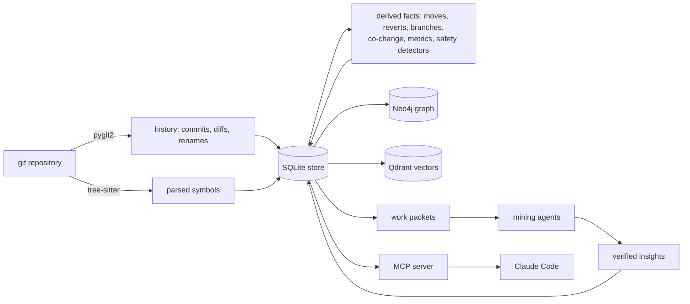

# Architecture

> Oracle is four Python packages, three data stores and a web dashboard. Data flows one way: git → store →
> (graph, vectors, packets) → Claude.

## The parts

| Part | What it does | Code |
|---|---|---|
| **Ingest pipeline** | Reads a repository and computes every deterministic fact | `packages/afd_oracle_ingest` |
| **Core** | Shared building blocks: settings, the store, database clients, the citation gate, insights | `packages/afd_oracle_core` |
| **MCP server** | The tools Claude Code calls | `packages/afd_oracle_mcp` |
| **Dashboard** | A local web app: add, update, mine and browse repositories | `packages/afd_oracle_ui` (FastAPI backend, React front end in `web/`) |
| **Agents and workflows** | The AI side of mining | `.claude/agents`, `.claude/workflows` |
| **Infrastructure** | Neo4j and Qdrant, run in Docker | `infra/docker-compose.yml` |

## The three stores

1. **SQLite store** (`data/repos/<repo>/store.sqlite`). The **system of record**: every commit, file change, symbol,
   edge, candidate, packet, insight and finding. Everything else can be rebuilt from it, and it works with no
   databases running.
2. **Neo4j graph.** A copy of the store as a graph of files, symbols, commits, authors, branches and insights, linked
   by edges such as `TOUCHED`, `CALLS`, `IMPORTS`, `CO_COMMITTED` and `REVERTS`. Good for questions like "what is
   connected to this file within two steps?"
3. **Qdrant vectors.** Code, commits and verified insights turned into embeddings (lists of numbers that capture
   meaning), so Claude can search by meaning ("where is session expiry handled?") as well as by keywords.

There is also a **parse cache** (`data/parse_cache.sqlite`), which remembers the parse of every file version Oracle has
ever seen, so nothing is parsed twice.

## How data flows

1. **Ingestion** fills the store from git: history, parsed symbols and all derived facts. It also projects to Neo4j,
   embeds into Qdrant and builds work packets. See [Ingestion](ingestion/README.md).
2. **Mining** sends packets to AI agents and writes verified insights back into the store, and from there to Neo4j and
   Qdrant. See [Mining](mining/README.md).
3. **Change safety** is computed during ingestion and applied on demand by `assess_change` and `check_diff`. See
   [Change safety](change-safety/README.md).
4. **The MCP server** reads the store, graph and vectors, and answers Claude.

## How Claude gets access

- **The MCP server** is registered once for your user (`afd-oracle setup`), so Claude Code can use it in any folder.
- **The `afd-oracle` skill** tells Claude when to use it: call `identify_repo` first to recognise the repository, use
  `assess_change` before editing and `check_diff` after.
- **`/afd oracle <action>`** gives explicit commands. `/afd` is a shared router for all Agentic Fever Dream tools.

## Design principles

- **Store first, everything else is a projection.** If Neo4j is down, the core still works from SQLite.
- **Deterministic before AI.** Programs compute; AI only judges, and its judgements are checked.
- **Incremental.** Re-running only processes what is new. See [Incremental updates](ingestion/11-incremental.md).
- **Local and private.** Data stays on your machine; network use is explicit and opt-in.

Next: [Ingestion overview](ingestion/README.md)
