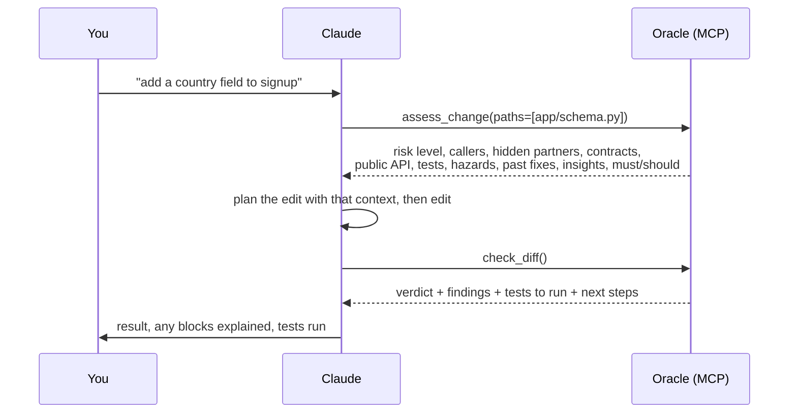

# Change safety overview

> Change safety is a set of programs, with no AI, that protect a code change. Before an edit, Oracle tells Claude
> what the change could affect. After the edit, it inspects the actual diff for anything dangerous, and gives a
> verdict: **pass**, **warn** or **block**.

## The problem it solves

When you ask Claude to add a feature, the risks are rarely in the lines it writes. They're elsewhere:
- **Regressions:** removing a check that a past bug fix added.
- **Breaking changes:** changing a function other people call.
- **Action at a distance:** a file somewhere else that silently depends on this one.
- **Security and race hazards:** a shell command built from input, or shared state written from many threads.
- **Logic bombs and supply-chain risks:** code that misbehaves on a date, or a misspelled dependency.

The safety layer computes the facts needed to catch these during ingestion. It then applies them through two tools
Claude calls around every edit.

## Two moments

- **[`assess_change`](11-assess-change.md)**, before: "what could this touch?"
- **[`check_diff`](12-check-diff.md)**, after: "did this change do anything dangerous?"

## Severities

Every finding has one of three severities:

| Severity | Meaning | What Claude must do |
|---|---|---|
| **block** | Very likely to break something: a breaking API change, a removed guard from a past fix, a removed contract that others still use, a shell or SQL injection sink, encoded exec, a typosquatted dependency | Fix it, or get your explicit acknowledgement |
| **warn** | Needs a human look: a hidden partner not updated, an untested change, a possible race, a swallowed exception | Review and explain |
| **info** | Context: weak hashes for checksums, test-only patterns, documentation examples | Nothing required |

Code in tests and in documentation (`.md`, `.rst`, `.txt`) is graded **info**: it's context, not a hazard.

## The detectors

Computed during ingestion (the `safety` step, about 11 seconds on flask) and stored in the repository's store:

| # | Detector | Answers | Table |
|---|---|---|---|
| 1 | [Test map](01-test-map.md) | Which tests exercise this code? | `test_map` |
| 2 | [String contracts](02-string-contracts.md) | What is linked to this only by a shared name? | `contracts` |
| 3 | [Type-aware call graph](03-call-graph.md) | Who really calls this, including through overrides? | `edges` |
| 4 | [Public API](04-public-api.md) | Is this used by the outside world, and did its signature break? | `api_surface` |
| 5 | [Bug-fix lineage](05-fix-lineage.md) | Which past fixes protect this code? | `fix_events` |
| 6 | [Security](06-security.md) | Injection, unsafe deserialisation, disabled TLS, secrets… | `findings` |
| 7 | [Races](07-races.md) | Shared mutable state, lazy init, check-then-act | `findings` |
| 8 | [Logic bombs and supply chain](08-logic-bombs-and-supply-chain.md) | Date or host gates, encoded exec, typosquats, install hooks | `findings` |
| 9 | [Error handling and performance](09-error-handling-and-performance.md) | Swallowed errors, I/O in loops | `findings` |
| 10 | [Risk score](10-risk-score.md) | How careful should we be here, from 0 to 100? | `risk` |

On flask the step produced:
- 1,183 contract entries across 408 keys
- 586 test links
- 314 public symbols across 7 refs
- 356 fix commits
- 292 typed call edges

It left 7 warnings, all of them genuine.

## Using it

- [`assess_change`](11-assess-change.md) and [`check_diff`](12-check-diff.md): the gate itself
- [Mutation testing](13-mutation-testing.md): are the tests actually strong enough?
- [GitHub discussions](14-github-discussions.md): the "why" from pull requests and issues
- [Limits](15-limits.md): what this can and can't promise

Next: [Test map](01-test-map.md)
