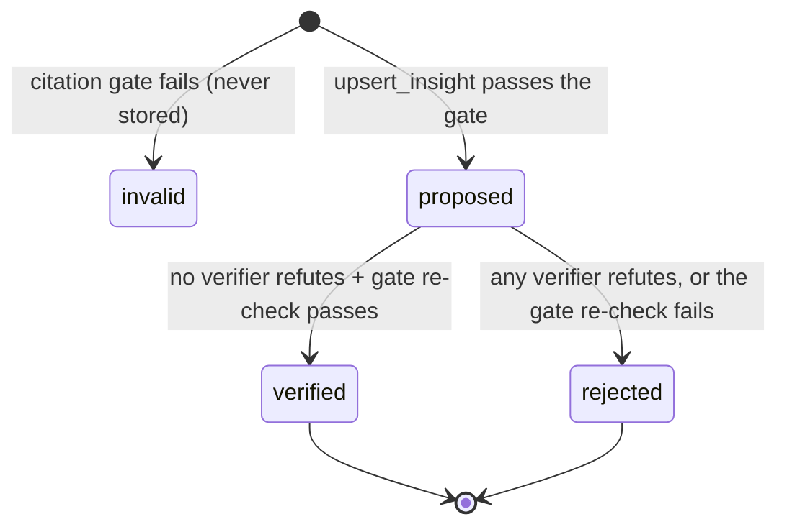

# Insights: storage and lifecycle

> An insight is a short, cited finding that survived the citation gate and a skeptical verifier. Insights are stored
> in the repository's store, mirrored into the graph and vector database, and kept across updates.

## What an insight contains

| Field | Example |
|---|---|
| `label` | `AntiPattern`, `RejectedAttempt` or `Pattern` |
| `kind` | `hidden_coupling`, `reverted_feature`, `abandoned_branch`, `god_class`, `cycle`, `leaky_abstraction`, `duplicated_logic`, `idiom`, … |
| `title` | "Signup fields are defined twice: Python validation and TS form must be edited together" |
| `summary` | What happens, why it matters, what the evidence shows |
| `severity` | `high`, `medium`, `low` or `info` |
| `confidence` | 0–1, as given by the analyst |
| `citations` | `commits` (hash + role), `files` (path + at_commit), `symbols` (uid) |
| `status` | `proposed` → `verified` or `rejected` |
| `verifier_notes`, `votes` | Why the verifier decided, with each vote's model and reason |
| `workflow_run`, `created_by_model` | Where it came from |

## Lifecycle

- **Proposed** insights are visible to tools, but they are not trusted and not embedded.
- **Verified** insights are projected into Neo4j as `(:Insight)` nodes. They are linked by `EVIDENCED_BY` edges to
  commits and `CONCERNS` edges to files and symbols, and embedded into the `architectural_insights` collection.
- **Rejected** insights keep their verifier notes, so you can see why. They are removed from the vector collection.

## How Claude uses them

- The `afd-oracle` skill tells Claude to check insights before answering "why" questions, and before editing files
  they concern.
- `list_insights` filters by status, kind and repository. `search_qdrant` over `architectural_insights` finds
  insights by meaning.
- `assess_change` includes every insight that cites a file or symbol you're about to change (see
  [assess_change](../change-safety/11-assess-change.md)).
- The dashboard's **Insights** tab lets you browse them, with citations and linked diffs.

## Why there may be fewer than you expect

Only candidates that survive the noise filter become packets. Only packets with real evidence become proposed
insights, and only those that survive refutation become verified. A long-lived repository may yield dozens rather
than thousands of verified insights. That's by design: each one should be safe to rely on.

## Where in the code

- `afd_oracle_core/insights.py`: `InsightService` (`upsert`, `set_status`, projection, embedding)
- `afd_oracle_mcp/server.py`: `upsert_insight`, `set_insight_status`, `list_insights`, `verify_citations`

Next: [The candidate catalogue](07-catalogue.md)
